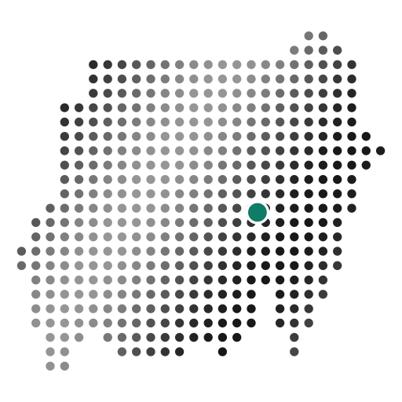

# Sudan Atlas

[](https://doi.org/10.5281/zenodo.24191932) [](https://www.npmjs.com/package/sudan-atlas) [](https://pypi.org/project/sudan-atlas/)

An open toolkit that turns messy Sudanese place names into official codes and draws Sudan's 18 states, the Abyei PCA area and 189 localities as maps, in Arabic and English. Use it on the website, or in your own code with the npm and PyPI packages.

**Website: [atlas-sudan.vercel.app](https://atlas-sudan.vercel.app)** · [Map](https://atlas-sudan.vercel.app/map/) · [Map-maker](https://atlas-sudan.vercel.app/maker/) · [Documentation](https://atlas-sudan.vercel.app/docs/)

> **Status:** live website; packages 0.1.2 on [npm](https://www.npmjs.com/package/sudan-atlas) and [PyPI](https://pypi.org/project/sudan-atlas/); data release 2026.1 (COD-AB Sudan v03).

## On the website

Everything works in Arabic (right to left) and English, on phones and desktops, and runs in your browser.

- **[Map](https://atlas-sudan.vercel.app/map/)**: every state and locality with its official Arabic and English names, P-code and area. Search in either language and spelling, zoom and pan, open a state to see its localities, and export the view as SVG or PNG, or the places as CSV. Links keep their place (`/map/?focus=SD02&place=SD02114`).
- **[Map-maker](https://atlas-sudan.vercel.app/maker/)**: open a CSV or Excel file of place names, check the names the matcher is unsure about, and get a choropleth map with a ranked bar chart and a legend showing how many places fall in each colour band. Download the map (SVG or PNG) and your file with P-codes added. Rows that are not on the map are listed, never dropped silently, and your file never leaves your device.
- **AI assistants (MCP)**: `https://atlas-sudan.vercel.app/api/mcp` is a free, read-only [Model Context Protocol](https://modelcontextprotocol.io) server with tools to match names, search, look up places and populations, and get boundaries. In Claude Code: `claude mcp add --transport http sudan-atlas https://atlas-sudan.vercel.app/api/mcp`.
- **[Documentation](https://atlas-sudan.vercel.app/docs/)**: how to use the packages after installing them, with Python and JavaScript examples, a full reference and how matching works.

## Quick start

**JavaScript** (`npm install sudan-atlas`)

```js
import { match, getFeature } from "sudan-atlas";
match("El Hasaheesa", { stateHint: "Al Gezira", level: 2 }).pcode; // "SD15034"
const shape = await getFeature("SD15034", "medium");               // GeoJSON Feature
```

**Python** (`pip install sudan-atlas`, or `"sudan-atlas[geo]"` for GeoDataFrames)

```python
from sudan_atlas import match, get_localities
match("الفاشر", level=2)["pcode"]  # 'SD02114'
get_localities("SD15")              # the localities of Aj Jazirah
```

**In a browser with no build step**: `import { match } from "https://cdn.jsdelivr.net/npm/sudan-atlas@0.1/dist/index.js"`; the data files are on jsDelivr too, under `…/sudan-atlas@0.1/data/`.

Examples: a [D3 choropleth from a messy spreadsheet](examples/d3-choropleth/), a [state-and-locality picker](examples/dropdown/), and a [Python notebook](examples/python/sudan_atlas_quickstart.ipynb).

## What a match returns

```js
{
  pcode: "SD15034", name_en: "Al Hasahisa", name_ar: "الحصاحيصا", level: 2,
  score: 0.9,            // 0 to 1
  method: "fuzzy",         // exact, variant or fuzzy; ambiguous or none when there is no match
  alternatives: [ ... ]    // the next three candidates, each with pcode, names, level and score
}
```

When the best candidate scores below 0.82, or another place scores almost as high, `pcode` is `null` (`None` in Python) and `alternatives` lists the candidates: the matcher never guesses silently. "Gallabat" lies on a locality border and "Abyei" can mean the Abyei PCA area or the West Kordofan locality, so both come back as `ambiguous` for a person to decide. A state hint (a P-code or a state name in any spelling) and a level (1 = state, 2 = locality) settle most ambiguity.

On 299 real names from public humanitarian datasets, each checked by hand, the matcher finds the right place first time for 94.9 %, puts it among the top three for 99.6 %, and names no wrong place; see [`docs/MATCHER_EVALUATION.md`](docs/MATCHER_EVALUATION.md). The Python and JavaScript packages share the same rules and return identical results.

## What it does

- **Name matching**: `El Fasher`, `Al Fashir` and `الفاشر` all resolve to the same official P-code, with a confidence score and alternatives.
- **Boundaries**: states (admin 1) and localities (admin 2) as GeoJSON and TopoJSON at three resolutions, following OCHA's COD-AB exactly.
- **Bilingual**: every feature carries `pcode`, `name_en` and `name_ar`; every page of the website supports right-to-left layout.
- **Private and static**: everything ships as files and runs on the client. Files opened in the map-maker are never uploaded.

## Repository layout

```text
data/          boundaries, gazetteer and test fixtures (one source of truth)
pipeline/      Python scripts that rebuild data/ from data/raw/
packages/js/   npm package: data + matcher (TypeScript)
packages/py/   PyPI package: same API (Python)
site/          website: map, map-maker, documentation (Vite + TypeScript + D3)
examples/      D3 map, dropdown form, Python notebook
docs/          DATA_POLICY.md, SOURCES.md, GAZETTEER.md, MATCHER_EVALUATION.md, PUBLISHING.md
```

## Roadmap

1. ~~Data foundation: clean, validated, versioned boundaries~~ (done, release 2026.1)
2. ~~Name matcher: Arabic and English, with confidence scores~~ (done)
3. ~~Packages: npm and PyPI~~ (done, 0.1.2)
4. ~~Website and map-maker~~ (done, [atlas-sudan.vercel.app](https://atlas-sudan.vercel.app))
5. Hosted API (only if users ask)

## Running the website

```sh
cd site
npm install
npm run dev       # http://localhost:5173, with the package source and boundary files from this repository
npm run build     # type-check and build into site/dist/
```

The site uses the `sudan-atlas` package straight from `packages/js/src`, so it always matches the published packages. Vercel builds and deploys it from `site/` on every push to `main`; other branches get preview deployments. Visits are counted with Vercel Analytics, which uses no cookies. Feature use is counted by the site's own function, [`site/api/count.ts`](site/api/count.ts): one number per page, event and file type (for example "maker, map export, PNG"), kept in an Upstash Redis database connected through Vercel's Marketplace. It stores no IP address, cookie, file name or value, and does nothing until the database is connected. `GET /api/count` returns the counts.

## Rebuilding the data and packages

```sh
make setup      # Python venv, mapshaper and the JS package's tools
make fetch      # download COD-AB, GeoNames and Wikidata into data/raw/
make data       # rebuild and validate data/boundaries/
make gazetteer  # rebuild data/gazetteer/ (places and spellings)
make evaluate   # measure the matcher; writes docs/MATCHER_EVALUATION.md
make golden     # write the results both packages must reproduce
make packages   # build the npm and PyPI packages
make test       # Python tests;  make test-js for the TypeScript package
make preview    # then open http://localhost:8000/pipeline/preview/
```

Publishing steps: [`docs/PUBLISHING.md`](docs/PUBLISHING.md).

## Citing Sudan Atlas

If you use Sudan Atlas in a report, paper or product, please cite it:

> Shennan, A. (2026). *Sudan Atlas: official names, P-codes and boundaries for Sudan's states and localities*. Zenodo. https://doi.org/10.5281/zenodo.24191932

Each GitHub release is archived on [Zenodo](https://doi.org/10.5281/zenodo.24191932); the "Cite this repository" button on GitHub gives the citation in APA and BibTeX, from [`CITATION.cff`](CITATION.cff). Please also credit the boundary source: "OCHA (COD-AB Sudan), via HDX".

## Help improve it

Found a spelling the matcher misses, or a name that should match differently? [Open an issue](https://github.com/aminshennan/sudan-atlas/issues/new) with the name as written and the place it refers to. Every new spelling is reviewed before it is added.

## Licence

- Code: [MIT](LICENSE)
- Boundaries: CC BY 3.0 IGO, derived from OCHA's COD-AB ([details](LICENSE-DATA))
- Gazetteer additions (variant spellings, normalisation rules, test cases): CC BY 4.0
- Sources are listed in [`docs/SOURCES.md`](docs/SOURCES.md). Boundary choices are documented in [`docs/DATA_POLICY.md`](docs/DATA_POLICY.md).

Boundaries are shown for humanitarian, research and practical use and do not imply any opinion on the legal status of any territory.

Made by [Amin Shennan](https://aminshennan.com).
