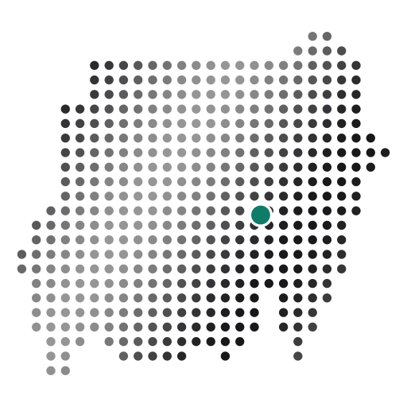

# Sudan Atlas toolkit

[](https://doi.org/10.5281/zenodo.24191931) [](https://www.npmjs.com/package/sudan-atlas) [](https://pypi.org/project/sudan-atlas/) [](https://mcptry.com/servers/io.github.aminshennan/sudan-atlas)

An open toolkit that turns messy Sudanese place names into official codes, and gives the names (Arabic and English) and boundaries of Sudan's 18 states, the Abyei PCA area and 189 localities. It contains:

- **Python and JavaScript packages** (`sudan-atlas` on PyPI and npm) with the same matcher, data and results;
- **the data**: boundaries following OCHA's COD-AB for Sudan (v03), a gazetteer of reviewed spellings, and the pipeline that builds them;
- **a skill for AI assistants**, and a Claude Code plugin that adds it together with the Sudan Atlas MCP server;
- **an evaluation** of the matcher on real humanitarian data.

> **Status:** packages 0.1.5 on [npm](https://www.npmjs.com/package/sudan-atlas) and [PyPI](https://pypi.org/project/sudan-atlas/); data release 2026.1 (COD-AB Sudan v03).

**Use it online:** the website [atlas-sudan.vercel.app](https://atlas-sudan.vercel.app) is built on this toolkit: a [map](https://atlas-sudan.vercel.app/map/) of every state and locality, a [map-maker](https://atlas-sudan.vercel.app/maker/) that turns a spreadsheet of place names into a map (in the browser; files never leave your device), and the [documentation](https://atlas-sudan.vercel.app/docs/).

## Quick start

**JavaScript** (`npm install sudan-atlas`)

```js
import { match, getFeature } from "sudan-atlas";
match("El Hasaheesa", { stateHint: "Al Gezira", level: 2 }).pcode; // "SD15034"
const shape = await getFeature("SD15034", "medium");               // GeoJSON Feature
```

**Python** (`pip install sudan-atlas`, or `"sudan-atlas[geo]"` for GeoDataFrames)

```python
from sudan_atlas import match, get_localities
match("الفاشر", level=2)["pcode"]  # 'SD02114'
get_localities("SD15")              # the localities of Aj Jazirah
```

**In a browser with no build step**: `import { match } from "https://cdn.jsdelivr.net/npm/sudan-atlas@0.1/dist/index.js"`; the data files are on jsDelivr too, under `…/sudan-atlas@0.1/data/`.

**AI assistants**: in Claude Code, add the plugin, which brings the skill and the [MCP server](https://atlas-sudan.vercel.app/docs/#mcp):

```text
/plugin marketplace add aminshennan/sudan-atlas
/plugin install sudan-atlas@sudan-atlas
```

Or add the server alone, in any client that supports remote MCP servers: `claude mcp add --transport http sudan-atlas https://atlas-sudan.vercel.app/api/mcp`. The skill works in other agents too: copy [`plugins/sudan-atlas/skills/sudan-atlas/`](plugins/sudan-atlas/skills/sudan-atlas/SKILL.md) into the agent's skills folder. Names sent to the MCP server are processed on the server and not stored; each address may make 60 requests a minute.

Examples: a [D3 choropleth from a messy spreadsheet](examples/d3-choropleth/), a [state-and-locality picker](examples/dropdown/), and a [Python notebook](examples/python/sudan_atlas_quickstart.ipynb).

## What a match returns

```js
{
  pcode: "SD15034", name_en: "Al Hasahisa", name_ar: "الحصاحيصا", level: 2,
  score: 0.9,            // 0 to 1
  method: "fuzzy",         // exact, variant or fuzzy; ambiguous or none when there is no match
  alternatives: [ ... ]    // the next three candidates, each with pcode, names, level and score
}
```

When the best candidate scores below 0.82, or another place scores almost as high, `pcode` is `null` (`None` in Python) and `alternatives` lists the candidates: the matcher never guesses silently. "Gallabat" lies on a locality border and "Abyei" can mean the Abyei PCA area or the West Kordofan locality, so both come back as `ambiguous` for a person to decide. A state hint (a P-code or a state name in any spelling) and a level (1 = state, 2 = locality) settle most ambiguity.

We tested the matcher on 299 place names copied from eight public HDX datasets (UNHCR refugee sites, OCHA people reached and 3W, IOM DTM, IPC, schools, floods and population tables): 253 that should match a state or locality and 46 that should match nothing (camps, villages, names shared by several places, header and total rows). With a state hint, it finds the right place first time for 94.9 % of the 253, puts it among the top three for 99.6 %, and named no wrong place for any of the 299. Without a state hint: 85.0 % first time and 2.3 % wrong matches. The threshold was chosen on this same set, so these figures describe it rather than an independent test, and new data will produce some wrong matches; please [report them](https://github.com/aminshennan/sudan-atlas/issues). Details and every failure: [`docs/MATCHER_EVALUATION.md`](docs/MATCHER_EVALUATION.md). The Python and JavaScript packages share the same rules and return identical results.

**Independent test.** We then measured the matcher once, unchanged, on 148 names it had never seen, from 16 other HDX datasets ([`docs/MATCHER_HOLDOUT.md`](docs/MATCHER_HOLDOUT.md)). With a state hint it found the right place first time for 90.2 % of the 92 state and locality names (95 % range 82–95 %) and sent one of them to a wrong place. But 9 of the 56 village, camp and market names, which should match nothing, were matched to a locality, mostly where the data had no state column or the site is named after its town. Give the state whenever you have it, and check any match that comes from a village, camp, market or site column.

## What it does

- **Name matching**: `El Fasher`, `Al Fashir` and `الفاشر` all resolve to the same official P-code, with a confidence score and alternatives.
- **Boundaries**: states (admin 1) and localities (admin 2) as GeoJSON and TopoJSON at three resolutions, following OCHA's COD-AB exactly.
- **Bilingual**: every feature carries `pcode`, `name_en` and `name_ar`.
- **Runs on your machine**: the packages ship the data as files and match locally, with no network calls (boundaries can also be loaded from a CDN in the browser).

## Repository layout

```text
data/          boundaries, gazetteer and test cases (one source of truth)
pipeline/      Python scripts that rebuild data/ from data/raw/
packages/js/   npm package: data + matcher (TypeScript)
packages/py/   PyPI package: same API (Python)
plugins/       Claude Code plugin: the skill plus the MCP server
examples/      D3 map, dropdown form, Python notebook
docs/          DATA_POLICY.md, SOURCES.md, GAZETTEER.md, MATCHER_EVALUATION.md
```

## Citing Sudan Atlas

If you use Sudan Atlas in a report, paper or product, please cite it:

> Shennan, A. (2026). *Sudan Atlas: official names, P-codes and boundaries for Sudan's states and localities*. Zenodo. https://doi.org/10.5281/zenodo.24191931

Each GitHub release is archived on [Zenodo](https://doi.org/10.5281/zenodo.24191931); the "Cite this repository" button on GitHub gives the citation in APA and BibTeX, from [`CITATION.cff`](CITATION.cff). Please also credit the boundary source: "OCHA (COD-AB Sudan), via HDX".

## Help improve it

Found a spelling the matcher misses, or a name that should match differently? [Open an issue](https://github.com/aminshennan/sudan-atlas/issues/new) with the name as written and the place it refers to. Every new spelling is reviewed before it is added.

## Licence

- Code: [MIT](LICENSE)
- Boundaries: CC BY 3.0 IGO, derived from OCHA's COD-AB ([details](LICENSE-DATA))
- Gazetteer additions (variant spellings, normalisation rules, test cases): CC BY 4.0
- OpenStreetMap town spellings: ODbL 1.0, © OpenStreetMap contributors. They are kept in their own file (`variants_osm.json`), so the ODbL covers that file only, not the other data or your matching results ([details](LICENSE-DATA))
- Sources are listed in [`docs/SOURCES.md`](docs/SOURCES.md). Boundary choices are documented in [`docs/DATA_POLICY.md`](docs/DATA_POLICY.md).

Boundaries are shown for humanitarian, research and practical use and do not imply any opinion on the legal status of any territory.

Made by [Amin Shennan](https://aminshennan.com).
